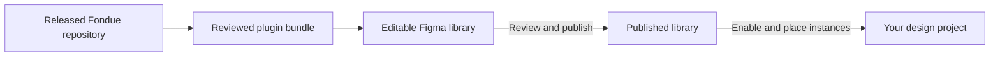
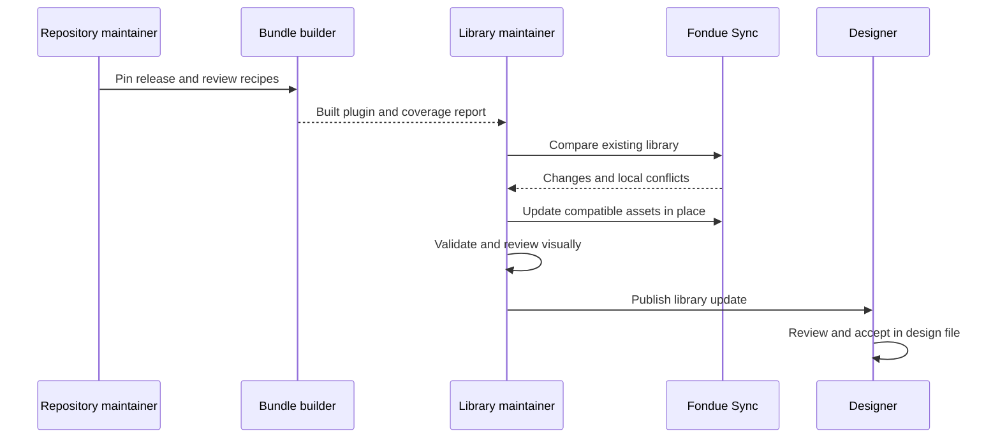

# Fondue Sync

Fondue Sync brings the released Fondue design system into Figma as an editable, reusable library. It creates variables, shared styles, icons, components and variants, with usage guidance and example screens that help designers build consistent interfaces.

The Fondue repository defines the source assets. A library maintainer imports a reviewed release into a dedicated Figma file, publishes it, and designers use that library in their own projects.

**Designers:** use the published library; you do not need to install the plugin. **Library maintainers:** install Fondue Sync to generate and update the shared library. **Developers:** maintain the release inputs and the mappings that turn code into native Figma components.

[Readable guide in Pages](https://chatgpt.com/space/page_84703405c4548191af39dde3ba597cef) · [Repository](https://github.com/DannyRuchtie/fondue-sync) · [Current library review file](https://www.figma.com/design/ZmOzqBnHNixUTV1TqRtBHs)

## From the repository to your design project


A Fondue release supplies the tokens, icons, component source and available documentation. Fondue Sync packages that release together with reviewed Figma recipes. A recipe describes how a component becomes editable Figma layers, including its layout, variants and token connections.

The plugin populates a dedicated library file. Designers then enable the published library, place linked instances, and compose their own screens. The example pages provide starting layouts based on production Brands, Libraries and Guidelines overviews, using synthetic content.

The file has two page groups. **Library / …** pages are for browsing components, icons, charts and examples, with readable previews and usage guidance. **Source components / …** pages hold the actual main components and variant sets maintained by the plugin. Browsing previews are linked instances of those source components; both groups belong to the same library.

In the illustration, solid arrows show the current library workflow. Dashed paths show planned prototype export, live API data and proposed changes back to Fondue. Those future paths are not current plugin actions.

The plugin runs when a maintainer opens it. It uses the release packaged in its build; it does not watch the repository or fetch the latest code automatically.



## Install the plugin and create the library

### If you only want to design

Ask your library maintainer for the published Fondue library, enable it in your Figma file, and start placing components from Assets. You can skip the plugin installation.

### If you maintain the library

You need Figma desktop, permission to edit the library file and run development plugins, and the required ABC Diatype and Cranny font faces. Publishing also requires the appropriate Figma workspace permissions and plan.

For the current development build, get the complete built plugin folder from a maintainer. Keep its files together and select `dist/manifest.json` when importing. If you are building it yourself, see **Technical setup and maintenance** below.

1. Create or open the Figma Design file that will hold the shared library. Use a separate test file for your first import.

2. In Figma desktop, choose **Plugins → Development → Import plugin from manifest**.

3. Select **dist/manifest.json**, then run **Fondue Sync** from the Development menu.

4. Choose **Import Fondue**.

5. Review the reported source release, warnings and coverage. Run **Validate**, then inspect the generated pages visually.

6. Publish the library after review.

The importer creates native editable assets. Missing required fonts stop the operation rather than silently substituting Inter. The current plugin is a development build; coverage varies by component, so review the [coverage report](https://github.com/DannyRuchtie/fondue-sync/blob/main/docs/coverage.json) before relying on a particular state.

## Make changes that reach Figma

Make durable library changes in their owning source, then ask a maintainer to prepare and sync a new build. Editing a generated description or main component directly in Figma does not update the repository; it can be reported as a local conflict on the next sync.

| What you want to change | Where the change belongs | How it reaches Figma |
| --- | --- | --- |
| Component purpose and when or how to use it | Released Fondue component metadata, where available | The builder reads the metadata and generates descriptions and guides |
| Component behavior, public properties or states | Fondue component source, with stories and metadata updated alongside it | A maintainer updates the reviewed Figma recipe for the supported representation |
| Colors, typography and other design tokens | Fondue’s existing token authoring process and committed release outputs | The builder imports the released token values, aliases and modes |
| Native component structure, variants, spacing or bindings | Reviewed recipes in the Fondue Sync repository | Rebuild the bundle and plugin, then compare and update |
| Reusable patterns, example layouts and dummy content | Fondue Sync pattern and example recipes | Update the generated references through the plugin |
| A product screen you are designing | Your own Figma design file | Your composition stays yours; its linked library instances can receive updates |

### Write component guidance with the component

Add or revise guidance when introducing a component, changing its intended use, adding a supported state, or finding that designers need clearer direction. Explain its purpose, when to use it, how to configure it, and any important limitations.

Where released metadata exists, the importer reads **description** for purpose, **instructions** for usage, and related-component references. For example, the component metadata convention is `packages/components/src/components/Button/Button.metadata.json` in Fondue.

The plugin adds the exposed Figma properties, representation limits and source links. It writes a native component description and documentation link, plus a concise guide beside the family. A source link points to the pinned release commit, so designers can see which implementation the imported guidance describes.

If released guidance is missing, the generator uses labeled Fondue Sync editorial guidance. Improve the upstream metadata for guidance that belongs to Fondue itself; use recipe documentation for Figma-specific instructions.

### Keep specifications and native mappings together

The code, stories and metadata describe the released component. The Figma recipe defines the subset represented as native layers and properties. Adding a new React component or prop does not automatically create a faithful Figma equivalent: a maintainer must add or review its recipe and coverage.

For example, changing a Button color token can flow through its existing variable binding. Adding a new Button variant also requires a native representation, property mapping and visual review.

The plugin reads committed token outputs from the selected release. It does not pull live Figma token values, and it does not change the existing upstream token-authoring process.

Fondue’s upstream token builder currently loads the owning Figma variables and commits generated outputs with a release. Changes therefore follow that established ownership and approval process first. Fondue Sync consumes those approved outputs; do not edit its temporary source cache or run the upstream live token builder as part of a normal plugin rebuild.

## Publish and use the library

### Publish as a maintainer

After importing or updating, review the variables, shared text and effect styles, component properties, variants and example layouts. Read any partial coverage notes. Validate the file, then publish using Figma’s normal library workflow, including the Fondue release and relevant limitations in the publication notes.

Syncing the source file and publishing it are separate actions. The plugin does not publish for you.

### Use it in a design project

1. Open your own Figma Design file and enable the published Fondue library.

2. Place native instances from Assets and change their supported properties and variants.

3. Use a reusable pattern or copy an example frame as a starting layout, keeping its nested instances connected.

4. Compose your screen and apply supported text, image and property overrides.

5. When a new library version is published, review and accept the update in your file.

Keep instances connected if you want library updates. Detached components no longer receive them. Your screen’s overall composition remains your own; nested library instances follow compatible updates.

## Update the library to another release


A source change reaches designers through four steps: **prepare a new plugin build → update and review the library → publish → accept updates in design files**.

1. A repository maintainer pins a coherent Fondue release, reviews the native recipes, and rebuilds the bundle and plugin.

2. The library maintainer loads the new build, opens the existing library file, and runs **Compare**.

3. Review changes, warnings, local conflicts and retained removals before choosing **Update library**.

4. Run **Validate**, inspect the result visually, and publish it.

5. Designers review and accept the published updates in their own files.

Compatible changes update managed assets in place, retaining component and layer identities where supported. The plugin also arranges its generated galleries, documentation and reference examples. It does not regenerate designer-owned product screens.

If Compare reports a locally changed or missing managed asset, resolve that conflict before updating. Removed definitions are retained for an explicit migration. Do not clear the sync records to force a production library through an update.

A renderer change or release-specific documentation links can refresh many entries even when their geometry has not changed. Structural changes and existing overrides still need review; an update is not a guarantee that every screen requires no migration.

## Technical setup and maintenance

### Build the development plugin

Use Node.js 20 or newer and npm in the Fondue Sync repository.

```sh
npm ci
npm run build
```

This packages the checked-in release bundle. Import `dist/manifest.json` in Figma desktop. The bundle is embedded in the plugin, so an import does not require a live Fondue server or Figma token credentials.

### Prepare a release and verify it

```sh
npm ci
node scripts/prepare-source.mjs
npm run verify
```

The source preparation step downloads the pinned upstream release and verifies its commit. It can replace the task-owned `.cache/release` directory; do not keep authored work there. Verification regenerates the bundle, checks types, runs tests and builds the plugin.

The current baseline is **Fondue 13.11.1**, pinned to commit `ebcc9b8579a7f862f43a2732f5a5b9c3105e6796`. To adopt another release, update the tag and expected commit in `scripts/prepare-source.mjs`, plus `RELEASE`, `COMMIT` and registry provenance in `scripts/build-bundle.mjs`. Prepare the source, review changed components, tokens, recipes and coverage together, then regenerate and verify. Changing the version string alone is insufficient. Do not combine arbitrary package versions or use the adapted playground as the release source.

### Find the owning source

Paths below are relative to the Fondue Sync repository unless labeled upstream.

| Source | Responsibility |
| --- | --- |
| Upstream `packages/tokens/dist/` | Committed CSS, themes, JSON and token metadata consumed from the pinned release |
| Upstream component `*.metadata.json` files | Released purpose, usage and related-component guidance |
| `recipes/documentation.mjs`, `src/documentation.ts` | Metadata extraction, labeled editorial fallback, source links and concise family guides |
| `recipes/index.mjs`, `recipes/foundations.mjs`, `recipes/controls.mjs`, `recipes/patterns.mjs` | Reviewed native component definitions, complex parts, charts, rich text and represented properties |
| `recipes/examples.mjs`, `fixtures/demo.json` | Active product patterns, example screens and fictional content |
| `recipes/typography-bindings.mjs`, `recipes/paint-bindings.mjs`, `recipes/token-bindings.mjs` | Shared-style and variable mapping rules |
| `scripts/prepare-source.mjs`, `scripts/build-bundle.mjs` | Pinned source preparation and release-bundle generation |
| `src/` | Figma synchronization, rendering, metadata and plugin interface |
| `bundles/`, `docs/coverage.json` | Generated release bundle and coverage report; regenerate rather than editing by hand |

Some geometry bindings currently match numeric recipe values to tokens within the spacing, radius or border category. Review these mappings when the token scale changes; the builder does not trace every dependency in arbitrary React or CSS. Equal values do not prove the original source token reference. Values without a matching exported token remain explicitly labelled source-derived native constants.

### How synchronization works

The bundle carries stable definition identities, provenance and hashes. The plugin compares the previous import, the new definitions and the current managed Figma assets. Compatible changes are applied in place; local drift is reported before updating.

Tokens and shared styles are resolved before components so layers can reference their actual native IDs. Component descriptions, family guides, galleries and examples are generated from the same packaged definitions.



Run one maintainer sync per file at a time. Local automated checks verify generation and supported sync behavior; native Figma review verifies appearance, actual API behavior and instance preservation. Publication and cross-file consumer acceptance require their own validation.

For implementation details, use the [architecture](https://github.com/DannyRuchtie/fondue-sync/blob/main/docs/architecture.md), [verification checklist](https://github.com/DannyRuchtie/fondue-sync/blob/main/docs/verification.md), [runtime evidence](https://github.com/DannyRuchtie/fondue-sync/blob/main/docs/native-runtime-evidence.md), [example coverage](https://github.com/DannyRuchtie/fondue-sync/blob/main/docs/examples.md) and [remaining gaps](https://github.com/DannyRuchtie/fondue-sync/blob/main/docs/gaps.md).

Additional references: [native sections and browsing pages](docs/sections.md), [optical icon sources](docs/optical-icons.md), and [metadata storage measurements](docs/metadata-capacity.json).

## Planned extensions

The current plugin builds and updates the library. Prototype export, live API data and reverse synchronization are later phases.

A future exporter can use the Figma composition and component mappings to recreate a screen with actual released Fondue code components. Mock and live data providers would share a typed contract. The [connected prototype architecture](https://github.com/DannyRuchtie/fondue-sync/blob/main/docs/connected-prototypes.md) documents this direction; live API integration remains research only.

A future reverse workflow could propose supported library changes as a pull request against Fondue. Maintainers would review and merge them before a later release returns through the normal update flow.

## Ownership and illustration credits

Fondue source, tokens and icons remain owned by their upstream authors. Preserve the upstream license and attribution when redistributing a bundle.

The conceptual illustrations follow Martin’s [concept visuals](https://github.com/mkovacovsky-frontify/concept-visuals) planning principles and the requested perspective line art direction. See the [illustration sources and prompts](https://github.com/DannyRuchtie/fondue-sync/blob/main/docs/illustrations/README.md).
