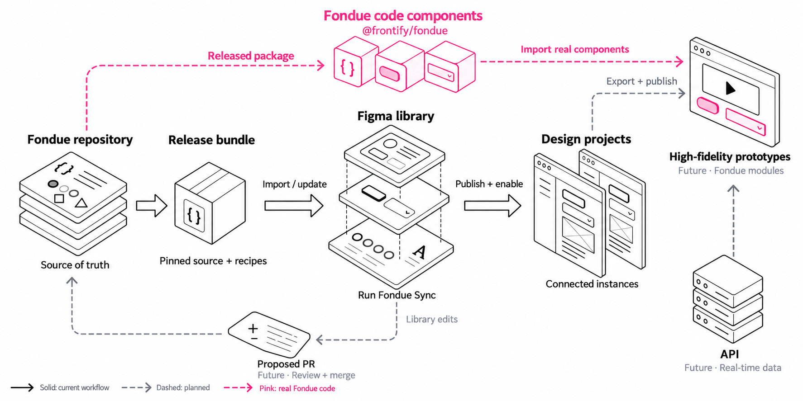
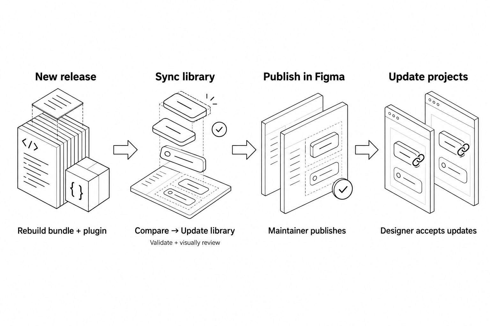

# Fondue Sync

Bring Fondue components, colors, spacing and styles into Figma—and propose improvements back to Fondue.

The plugin has two tabs: **Sync** to create or update the library, and **Push changes** to send selected edits for review.

**Just designing?** Enable the published Fondue library in your Figma file and use components from Assets. You only need the plugin if you maintain the library or want to propose changes.

[Open the library review file](https://www.figma.com/design/ZmOzqBnHNixUTV1TqRtBHs)

## Part 1: Set up the library

Ask a maintainer for the built plugin folder and the required ABC Diatype and Cranny fonts. You’ll need Figma desktop and permission to edit and publish the library.

1. Open a dedicated Figma library file. Use a test file for your first import.
2. Choose **Plugins → Development → Import plugin from manifest** and select `dist/manifest.json` from the plugin folder.
3. Run **Fondue Sync**, open **Sync**, and choose **Import Fondue**.
4. Run **Validate**, review any warnings, and check the components visually.
5. Publish the library through Figma so others can use it.

Keep component instances connected to receive future library updates.

**Surface content:** `Overlays / Flyout / Surface` supports a native **Content** slot. Choose `contentMode = slot`, select the Content region and add, duplicate, remove or arrange layers and linked components there. Shadow and corner-radius properties remain on the surrounding Surface. Original variants remain as `contentMode = sample` to preserve existing instances and text overrides; switching to slot mode is an explicit opt-in. See [native content slots](docs/content-slots.md) for ownership and maintenance.

**Editable compositions:** all 21 required families have native slot definitions, starting with Flyout body/actions, SegmentedControl items and Table rows/cells/header content. Use **Sync → Compose with slots → Install missing editable components** to add missing mains while preserving existing foundations, components and unrelated local drift. Then select a family and insert its linked editable component. Explicit helpers coordinate segment/radio selection, table columns, tab pairs, tree hierarchy and grid reflow. **Component composition overview** checks coverage across every source family; maintain the versioned [composition policies](recipes/composition-policies.json). See the [implementation checklist](docs/slot-implementation-checklist.md) and [workflow and validation limits](docs/content-slots.md).

All 21 families are installed in the live source library. Open the linked [core workflow examples](https://www.figma.com/design/ZmOzqBnHNixUTV1TqRtBHs?node-id=222-7153) or [the remaining families](https://www.figma.com/design/ZmOzqBnHNixUTV1TqRtBHs?node-id=228-7338). Native checks and published-consumer acceptance are tracked separately in the checklist.

Components are organized as **category / source family / profile**, for example **Buttons / Button / …**, **Inputs / TextInput / …**, and **Content / Accordion / pill**. Enable **Show subfolders** in Figma's Assets display settings to browse the hierarchy. Categories are Buttons, Inputs, Navigation, Feedback, Content, Overlays, Typography, and Layout. Charts, rich text, icons and product patterns keep their own domains.

Categories come from `src/component-categories.json` and are generated into the library bundle. For an existing library with local edits, choose **Organize components** to apply only the category names. It preserves current content and styling and changes only the name fields in the saved baseline; other drift remains visible in Compare. A locally renamed or missing main component stops organization for review. The action saves a recovery version and per-component name/baseline backups.

Import/Update also renames the existing component sets in place; recipe IDs, variant properties and instance connections stay intact. Local edits still appear as conflicts for review. Publish the updated library to make the organization available in consuming files. The plugin cannot change a designer's Show subfolders preference.

Product patterns compose the canonical base components in **Source components / Components**. Examples then use those pattern instances. Sync resolves the component references in dependency order; it does not create separate copies of the base controls for each pattern. Layout containers, illustrations and application-specific rich compositions can remain frames around those instances.

The bundled recipes are checked during the build for recreated controls and missing base-component references. An update migrates eligible managed controls to linked instances while retaining the pattern main components. Local edits remain conflicts for review rather than being overwritten. The generated [composition report](docs/product-pattern-composition.json) lists the reviewed pattern families and their dependencies.

Before every Import or Update, the plugin waits briefly and asks Figma to save a named **Before Fondue import/update** version. It proceeds only after Figma returns a version ID. If this fails, the operation stops before sync changes are made.

If an operation is interrupted, close the plugin, open **Show Version History** from the file name menu, select the matching **Before Fondue** version and choose **Restore This Version**. This restores the whole file, including changes collaborators made after that checkpoint; coordinate restoration with them. Reopen the plugin and Compare before retrying. Restoration does not automatically reverse published library versions or consumer updates.

This is a manual recovery point, not automatic rollback. Figma warns that very recent changes may be absent from a saved version; wait for the file to finish saving before starting. Access and retention depend on the file’s permissions and plan. Native restoration of variables, shared styles, managed metadata and instance connections must still be verified in a test file.

On launch, the plugin checks for a newer stable Fondue Sync release on GitHub and a newer published Fondue package on npm. The version notice links to available releases; **Check again** retries a failed check. Version checks time out after five seconds and do not block other actions. Import/Update separately require Figma to confirm the recovery version, so offline operation may be blocked. They send no document content or credentials. An unavailable check is not confirmation that you have the latest version.

These notices do not install updates or change the library automatically. Install a newer plugin build to update Fondue Sync. A newer upstream Fondue release must first be packaged and reviewed by a maintainer. Plugin update notices require a public GitHub release tagged with the matching package version, such as `v0.1.2`.

## Part 2: Update the library and push PRs

### Get an updated library

Ask a maintainer for a plugin build containing the new Fondue release. Then:

1. Open the existing library file and choose **Sync → Compare**.
2. Review the changes and resolve any conflicts.
3. Choose **Update library**, then **Validate** and check the result visually.
4. Publish the library. Designers can then review and accept the update in their files.

### Propose a change to Fondue

A pull request (PR) is a proposed change that maintainers review before adding it to Fondue.

Ask a maintainer to set up the PR connection first. They’ll provide a pairing secret to enter under **Push changes → Connect PR service**.

1. Change a Fondue object—for example, a badge’s corner radius or a button’s spacing—and select it.
2. Open **Push changes** and choose **Review selected object**.
3. Choose the changes to include. Reuse an existing design token (a named color, size or spacing value), or name a new one.
4. Add a title and explain why the change helps.
5. Choose **Preview PR diff** to review the proposed changes. Ask a maintainer to help resolve any source-mapping questions or conflicts.
6. Confirm the shared impact and choose **Create draft PR**. Open the GitHub link to follow the review.

Only the selection and its required tokens are proposed. A shared component or token change can affect other designs too. New tokens are included in the same PR, and normal instance labels stay local.

After approval, merge and release, a maintainer brings the change back through **Sync** and publishes the updated Figma library.

The push workflow is a development feature. Some changes need additional mapping support. Maintainers must review accessibility, component behavior and visual checks before merging. Creating a PR does not publish the library.

## For maintainers and developers

- [Designer composition requirements: slots, repeated items and the full component table](docs/designer-composition-requirements.md)
- [Build and maintain the plugin](docs/maintainer-guide.md)
- [Set up the PR connection and token builds](docs/push-changes.md)
- [Verification checklist](docs/verification.md)
- [Known gaps](docs/gaps.md)

Fondue assets belong to their upstream authors. See the [illustration credits](docs/illustrations/README.md).
