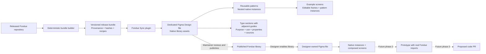

# Fondue Sync

Fondue Sync is a development Figma plugin that imports a **released, repository-derived Fondue library** into an ordinary Figma Design file. It creates editable native variables, styles, icons, components and variant sets. Designers consume the result through Figma's normal published-library workflow.

The definition input is the Fondue repository at a pinned release. The plugin does not read live Figma tokens. It does not change Fondue's existing token-authoring pipeline: generated token outputs committed with the release are the input here.

> **Development status:** the importer and its source-controlled recipes are an implementation of the library-generation flow. Recipe coverage is distinct from complete visual and behavioral parity with every React component and story. Check each recipe's `status` and `limitations` and the generated [coverage report](docs/coverage.json). Native Figma runtime and publication checks must be recorded separately from local build and test results.

**Current coverage:** 10 catalog entries have supported finite definitions, **42 remain partial**, and two providers are code-only. The generated catalog covers all 39 current visual component families, seven chart families, published RTE entries and additional chart primitives. This is not full-library acceptance.

**Native runtime validation:** repair and token-binding reconciliation are being verified in a user-authorized [clean rebuild](https://www.figma.com/design/ZmOzqBnHNixUTV1TqRtBHs) in the Frontify project. See the native evidence record for completed checks. Publishing and cross-file consumer acceptance remain separate checks.

## The process



The plugin runs when a person opens it. It does not run in the background, publish the library, or accept updates in designers' files.

## Install and load the development plugin

Prerequisites: Node.js 20 or newer, npm, and the Figma desktop application with permission to edit the intended library file and run development plugins. Publishing and consuming shared libraries depend on the target workspace's Figma permissions and plan.

```sh
npm ci
npm run build
```

1. Create or open a normal **Figma Design** file dedicated to the Fondue library. Use a new test file for the first import.
2. In Figma desktop, open **Plugins → Development → Import plugin from manifest**.
3. Select this repository's `dist/manifest.json`.
4. Run **Fondue Sync** from the Development menu.
5. Choose **Import Fondue** and review the resulting source version, coverage, warnings and gaps.
6. Validate and visually review the generated assets before publishing.

The generated [coverage report](docs/coverage.json) is the authoritative count of variables, styles, icons, current public families, native sets, variants and documentation. It distinguishes supported finite design definitions, partial representations, nonvisual code mappings and explicit gaps. Native set counts include split variant matrices and reusable compound parts; they do not equal the number of public React families. Source compound symbols and stories are inventoried separately from native representation. A definition marked supported still needs Figma runtime and visual acceptance; it does not claim browser behavior or every possible child composition.

The release bundle is embedded into the plugin build. Running the plugin does not need a live Fondue server or Figma token credentials. `npm run build` packages the checked-in bundle; `npm run bundle` regenerates it from the pinned source snapshot. See [architecture](docs/architecture.md) for the bundle inputs and token representation.

## Maintain and publish the library

The maintainer owns the dedicated library file.

1. Run **Import Fondue** for the initial generation.
2. Review token collections, modes and aliases, text/effect styles, native icons, component properties and variant sets.
3. Run **Validate**. Read the coverage report and recipe limitations; a successful structural validation is not proof of visual parity.
4. Select a main component or variant to read its native description and documentation links: purpose, intended use, exposed properties, source links and coverage notes. Each component type has its own native **Section**. Every profile set sits beside its existing usage guide inside that type section; all Button profiles, for example, share one Button section. The older Documentation page may remain empty after guides move into the catalog. See [native sections](docs/sections.md). Released metadata is reused where available; editorial guidance is labeled.
5. Review the **Patterns** and **Examples** pages as composition references. Patterns contain connected component instances; example screens are editable frames that compose those patterns. See [patterns and example screens](docs/examples.md).
6. Make any required recipe corrections in this repository, rebuild, and apply them through the plugin.
7. Publish using Figma's normal library publishing flow. Include the Fondue release and known limitations in the publication notes.

A generated asset is managed by stable Fondue identities, not just its displayed name. Keep managed definitions in the dedicated source file; compose product screens in consumer files.

## Consume the published library

Designers do not need this repository or the development plugin to use a published library.

1. Open your own Figma Design file.
2. Enable the published Fondue library through Figma's libraries panel.
3. Drag components from Assets into your file. These are native instances.
4. Compose layouts, change supported component properties and variants, and apply supported overrides.
5. Insert a published pattern when you need a reusable composition. Duplicate an example frame as a starting layout; keep nested instances connected to their library definitions.
6. Choose the appropriate token mode where supported.
7. When a maintainer publishes a new release, review and accept its library updates in your file.

Do not detach instances if you want them to remain connected to the published library. Figma's consumer update acceptance is a separate action from syncing and publishing the source library file.

## Update to another release

```mermaid
sequenceDiagram
    participant R as Repository maintainer
    participant B as Bundle builder
    participant P as Fondue Sync
    participant L as Library maintainer
    participant D as Designer
    R->>B: Pin coherent released source + reviewed recipes
    B->>B: Generate bundle, hashes and coverage
    L->>P: Open source library; Compare
    P->>P: Compare previous bundle, target bundle and managed assets
    P-->>L: Changes, local drift, gaps and retained removals
    L->>P: Update library
    P->>P: Apply compatible managed changes in place
    L->>L: Validate, visually review, publish in Figma
    L-->>D: Published library update
    D->>D: Review and accept update in own file
```

For a release change, update the pinned provenance and reviewed recipes together. Regenerate the bundle, inspect `docs/coverage.json` and the bundle diff, then run `npm run verify`. Do not mix newer component source with an independently chosen SDK, token package or playground installation.

Use **Compare** before **Update library**. The sync engine compares the last applied state, target definition and current managed state. Any preflight conflict or missing managed asset aborts the whole update before changes are applied. Local drift is reported rather than silently overwritten. Removed definitions are retained for explicit migration; they are not guessed to be safe to delete. Compatible changes preserve managed identities where the engine supports them. Preservation of consumer overrides depends on unchanged layer identities and compatible property changes; it is not a blanket guarantee for arbitrary structural rewrites.

See [architecture and update boundaries](docs/architecture.md) and the [verification checklist](docs/verification.md).

## Repository and release inputs

The initial baseline is `@frontify/fondue@13.11.1` from `Frontify/fondue`, tag `@frontify/fondue@13.11.1`, commit:

```text
ebcc9b8579a7f862f43a2732f5a5b9c3105e6796
```

The bundle records provenance and content hashes. The relevant current packages are components, tokens, icons, charts and published `rte`. The legacy root component catalog and `/legacyTokens` are excluded. The private, version-zero `rich-text-editor` revamp is excluded. `RouterProvider` and `ThemeProvider` are code/theme integration entries, not fabricated visual components. Public exports are reconciled with metadata so a missing SDK record does not silently remove a component such as Card.

| Path | Purpose |
| --- | --- |
| `scripts/` | Release-bundle generation and plugin packaging |
| `recipes/` | Reviewed native layer recipes, compound parts, authored patterns/examples, documentation and source mappings |
| `src/` | Bundle schema, native Figma synchronization engine and plugin UI |
| `bundles/` | Versioned repository-derived release bundle |
| `docs/coverage.json` | Generated inventory, representation status and gaps |
| `docs/pattern-coverage.json` | Complex component and chart source evidence, finite states and limitations |
| `docs/control-coverage.json` | Control recipe evidence and supported property matrices |
| `docs/foundation-coverage.json` | Typography/layout foundation evidence |
| `docs/examples.md` | Reusable patterns, editable screen examples and fixture contract |
| `tests/` | Bundle and synchronization verification |
| `dist/` | Loadable development plugin artifacts |

## Build and verification

```sh
npm ci
# Required before regenerating from a clean checkout; downloads the pinned source:
node scripts/prepare-source.mjs
npm run bundle
npm run typecheck
npm test
npm run build
# Or run the generation and checks together:
npm run verify
```

`prepare-source.mjs` prepares the task-owned `.cache/release` directory from the pinned upstream tag and verifies its commit. It can replace that cache; do not keep your own work there. It needs network access on a clean checkout. Building the checked-in plugin bundle does not.

`bundle` uses a pinned release source, not the adapted playground. It must not invoke Fondue's live token build: that build loads Figma variables and can clear generated outputs. The importer uses committed CSS, theme, JSON and metadata artifacts instead.

Local verification and runtime verification answer different questions. The tests check deterministic generation, valid references and supported synchronization behavior. The manual [Figma checklist](docs/verification.md) checks actual Plugin API execution, appearance, instance preservation and publication behavior. Record the exact commands and results used for a delivery; do not infer a passing native runtime from a passing TypeScript build.

## Technical scope and limitations

- **Tokens:** native primitive and semantic variables preserve supported aliases and light/dark values. Numeric units are converted from the source units for Figma. Composite typography and shadows use styles where representable; they are not mislabeled as native scalar variables. Value-only definitions and unrepresentable composites are reported.
- **Components:** source-controlled recipes describe editable native layers, Auto Layout, variants and supported bindings. Compound parts are independently reusable where represented. Native descriptions, documentation links and adjacent native usage guides explain purpose, use and exposed properties. Native Sections group each component type and keep its profiles together. Coverage does not mean every React prop, keyboard interaction, dynamic layout, chart data transformation or editor behavior is reproduced. Read recipe limitations before adopting the library for production design.
- **Patterns/examples:** authored compositions use real nested native instances, backed by synthetic fixtures. Example screens are ordinary editable frames; they do not query Frontify, navigate a running app or detach controls into flat snapshots.
- **Icons:** 420 public families include all 2,099 released optical drawings as native Size variants (12/16/20/24/32 where available). Slots choose an exact source size when present and report a source-size fallback otherwise; see [optical source coverage](docs/optical-icons.md). Repository SVGs become native editable icon assets. This is independent from whether every component recipe exposes an instance-swap property.
- **Fonts:** font availability is a runtime concern. Any fallback must be reported; review typography with the expected font installed before publishing.
- **Sync:** stable identities and the last applied state support comparison and compatible in-place updates. Local drift, removals and incompatible migrations require review. Do not reset the sync ledger to force an update on a production library.
- **Version status:** the bundled release, synchronized source file, last published library and consumer-file accepted version are separate states. The plugin cannot claim that all four match merely because import completed.

### Future phases

**Phase 1: library generation and updates.** The current plugin imports repository-defined native assets and reports coverage. Finish visual/runtime acceptance for the intended workspace before calling the library production ready.

**Phase 2: composed Figma screen → running Fondue prototype.** Planned mappings will connect stable component identities and supported properties to real `@frontify/fondue` imports through Code Connect/MCP-compatible records. This should support both Claude and OpenAI workflows. Prototype export is not an implemented plugin action. The [connected-prototype architecture](docs/connected-prototypes.md) describes pure Fondue presentation, typed navigation/search/asset capabilities, interchangeable mock/live providers, and a separate Frontify GraphQL adapter. Live authentication and tenant/schema compatibility remain unverified.

**Phase 3: Figma edits → proposed code PR.** A later reviewable proposal flow may translate supported edits into code changes. No automatic reverse sync, source modification, PR creation or merge is implemented by this plugin.

## Upstream ownership

Fondue source, tokens and icons remain owned by their upstream authors. This repository is a separate synchronization implementation. Preserve the upstream license and attribution when redistributing a release bundle; a private repository does not grant additional rights to upstream assets.

## Delivery evidence

See [verification evidence](docs/verification-evidence.md), the [independent review](docs/independent-review.md), [remaining gaps](docs/gaps.md), and [UTF-8 metadata-capacity measurements](docs/metadata-capacity.json). The coverage report separates native source profiles from unresolved source data and runtime acceptance. Run one maintainer sync per file at a time; the engine does not provide a distributed writer lock.

Current test destination: [PD Figma Sync — clean rebuild](https://www.figma.com/design/ZmOzqBnHNixUTV1TqRtBHs), accessed through the Frontify account. The initial blank component sets were caused by the native documentation-link limit; the importer now preserves the existing IDs while completing eligible partial imports. For installation, import `dist/manifest.json` in Figma desktop. See [native runtime evidence](docs/native-runtime-evidence.md) for the tested build and remaining boundaries.
