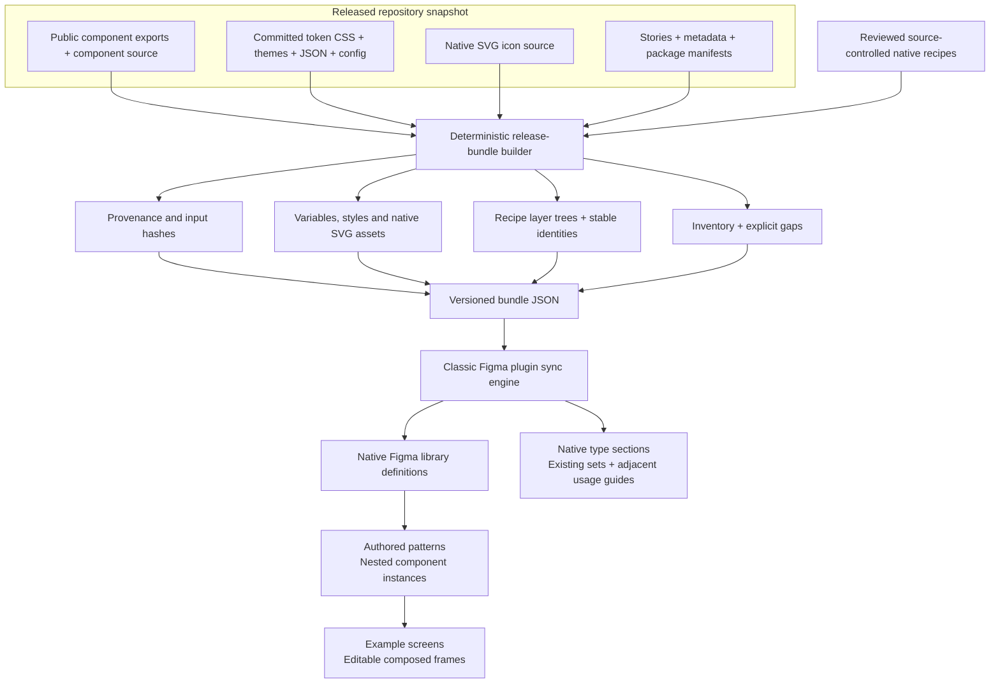
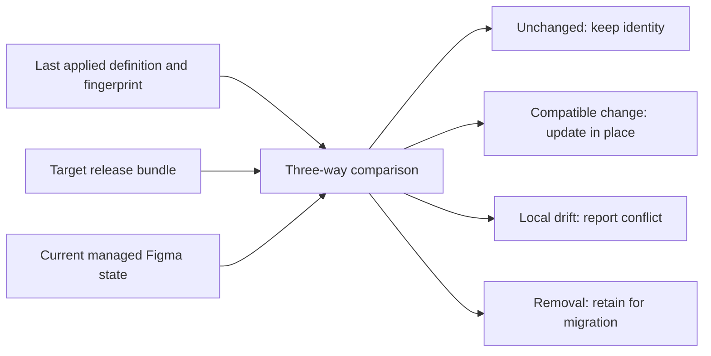

# Architecture and synchronization boundaries

## One release, one definition input

A release bundle is the portable boundary between repository analysis and the Figma runtime. The source of truth is a coherent released Fondue snapshot. The initial source tag is `@frontify/fondue@13.11.1` at commit `ebcc9b8579a7f862f43a2732f5a5b9c3105e6796`.

There is no incoming arrow from live Figma tokens. Fondue may author tokens in Figma upstream; that upstream pipeline remains separate. The sync builder consumes the generated outputs included with the chosen release. It does not run `packages/tokens/src/buildTokens.ts`, fetch the upstream token file, or require its edit permissions.

## Token model

The source SDK manifest alone is not the complete token definition. The builder also inspects committed CSS and theme declarations to recover primitive values, semantic alias relationships, typography primitives, numeric units and mode values. A semantic CSS declaration such as `var(--color-neutral-10)` remains an alias to the corresponding primitive identity where the Plugin API supports it.

The bundle separates primitive and semantic variables. Source light/dark values remain mode-specific. Figma uses numeric canvas values rather than CSS units; conversions must preserve the source scale and record the conversion basis. CSS composites are treated by their representability:

| Source definition | Native representation |
| --- | --- |
| Color primitive | COLOR variable |
| Semantic color alias | COLOR variable with alias values per mode |
| Numeric spacing, radius or width | FLOAT variable in canvas units |
| Supported string primitive | STRING variable |
| Typography composite | Text style with supported scalar bindings |
| Shadow composite | Effect style with supported effect values |
| Unsupported expression or unresolved reference | Explicit bundle gap or generation failure |

Variable code syntax retains the source CSS variable name. Component layer bindings refer to stable token IDs, so recipes do not depend on whatever variable IDs a particular Figma file receives. The runtime resolves these IDs after creating foundations.

A supported native style does not imply that every field in that style accepts a variable binding. The coverage report and runtime audit must distinguish an applied style from an individual bound property.

## Component model

A recipe contains:

- A stable Fondue identity, public name and package mapping.
- Source paths used to justify the native representation.
- A representation status and explicit limitations.
- Variants with stable identities and property values.
- A native layer tree with stable child identities, Auto Layout, source geometry and token bindings.

The engine resolves foundations before components. Native SVG icon assets are created independently. Editable layer trees are materially different from screenshots or flattened capture layers: designers can inspect layout, edit supported properties and place native instances. They still need recipe-specific parity checks against the released source.

A code-only provider is recorded as such. It must not become a fake component containing its name. Likewise, a complex chart or rich-text feature with partial representation must state what is covered and what remains missing.

## Identity, comparison and updates

Stable definition IDs are separate from Figma object IDs. A ledger maps the former to the latter and stores last-applied information. Managed metadata identifies generated assets without making the displayed name the sole ownership check. Shared metadata is useful to future mapping consumers, but it is not itself a completed Code Connect integration.

Comparison needs all three states: a changed target alone does not prove that the current canvas is safe to overwrite. The engine aborts the whole operation on any preflight conflict or missing managed asset, reports local drift, retains removed definitions, and avoids deleting user content by a name-prefix guess. Removed definitions, SVG geometry changes and incompatible variable or layer type changes need explicit migrations. A successful repeat run should be idempotent for the same bundle and unchanged managed state.

In-place update preserves the IDs the engine supports retaining. It does not make arbitrary component rewrites safe for existing instances. Renaming/removing a property, replacing a child layer or changing a component's structural role requires an explicit migration and instance testing. In consumer files, Figma's normal library update behavior and acceptance remain in control.

## Four independent version boundaries

| State | Meaning | Who advances it |
| --- | --- | --- |
| Available bundle | Released source packaged into the plugin | Repository maintainer builds plugin |
| Synchronized source file | Managed definitions applied to the library Design file | Library maintainer runs plugin |
| Published library | A reviewed source file version offered to consumers | Library maintainer publishes in Figma |
| Consumer accepted version | A particular design file has accepted library updates | Designer accepts updates in Figma |

The classic plugin can read and modify the file in which it runs. It cannot run invisibly as a daemon, publish a library on the maintainer's behalf, force acceptance in other files, or create a new Figma document as an ordinary Plugin API operation.

## Future mapping boundary

The source-controlled component identities, public package names, props and source mappings are the basis for a later Code Connect/MCP mapping layer. A future prototype exporter must select a supported composed screen, resolve its instances to real Fondue imports, translate supported properties, report unsupported design constructs, and produce a runnable result. It must not claim that a native component with a similar name proves correct application code.

Reverse code proposals now have a separate development workflow in the **Push changes** tab. Selection-only comparison produces reviewable code diffs against a known imported source release and checks the current target declarations. An authenticated loopback companion creates draft PRs after exact diff review; token proposals require an isolated upstream build and durable repository-owned definitions. This does not advance importer baselines or publish the library. See [push architecture, setup and coverage](push-changes.md).

The proposed live Frontify connection layer is documented in [connected prototypes](connected-prototypes.md). It is future scope and does not change the repository-only definition input for the library importer.

## Native documentation and composition

Every generated component set and variant receives a native description and documentation links. Released component metadata supplies purpose and usage when present; Fondue Sync labels editorial fallback guidance. Exposed native variant properties and coverage limitations appear alongside the guidance. Managed native **Sections** group component sets by type, such as Button, Text and DatePicker. Existing usage-guide frames move beside each matching set, inside its family section. Designers can read intended use and exposed properties next to the exact covered profiles. Moving a set or guide preserves its native IDs; the prior Documentation page may remain empty. See [section organization and identity](sections.md).

Source-derived complex component parts are distinct from the authored product patterns described in [examples](examples.md). A Dropdown.Item or Table.RowCell represents a released compound component. A NavigationShell pattern is a Fondue Sync composition that nests real native Fondue instances. An example screen is an ordinary editable frame composing patterns and controls. Publishing patterns makes them reusable library components; copying an example frame retains supported nested instance connections. Neither is a bitmap capture or evidence of a connected runtime application.

## Interoperable metadata and recovery

The namespace is `fondue_sync`. Logical records include `index` on the document, `applied`/`mapping` on managed assets, and `identity`, `component-binding`, `data-binding` and `example-binding` on applicable nodes. The repository also contains source identities, synthetic fixtures and typed capability contracts. Code Connect is not registered by this importer, and authored product patterns do not claim an import path in the published Fondue package.

Readers must use the generation manifest and chunk format implemented by `src/metadata.ts`; metadata is not guaranteed to fit in a single `getSharedPluginData` value. Every write is bounded by UTF-8 bytes including namespace and key. Small records fit inline in one atomic head entry. Larger records write new chunks before a small generation pointer is committed. An interrupted uncommitted generation remains invisible to readers. Checksums detect incomplete/corrupted committed records. This is entry-level consistency, not a transaction across Figma objects.

The root ledger uses a schema-2 header and sixteen independently committed asset-reference shards. A legacy flat schema-1 ledger is migrated before canvas allocation. Unchanged index records are skipped, avoiding whole-index rewrites for every asset. Allocated asset identities are saved before awaiting their baseline. A missing or divergent baseline is preserved for review. No cleanup guesses from a display name are authorized. Removed upstream assets and structural renames/removals require an explicit migration, keeping published instance identities intact until reviewed.

Font fallback warnings persist across plugin runs. Update retries source typography after a fallback, so installing a source font can repair typography without changing component/layer identities. Native typography and optical-size warnings still require visual review.
