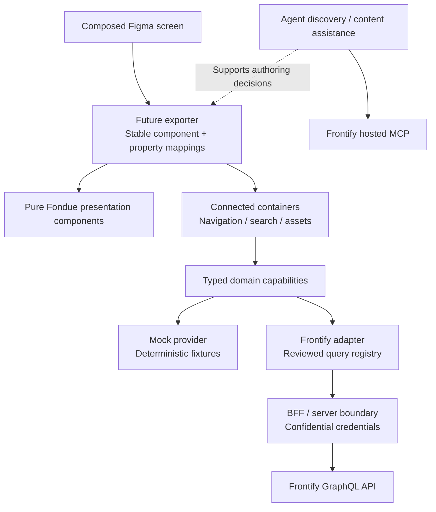

# Future phase 2: connected Frontify prototypes

**Architecture proposal, not an implemented plugin capability.** The current plugin generates and updates a native Fondue library. It does not authenticate to a Frontify tenant, query production content, or export a running connected prototype. No current credentials, tenant access or live endpoint behavior are assumed.

A future exporter should use real Fondue presentation components and attach data through explicit connected containers. Keep data access out of the presentation components: the same composed screen should work against a deterministic mock provider or a separately configured live provider.

The hosted MCP serves agent discovery/content-access workflows. It is a separate integration from a browser prototype's runtime data provider. Its existence does not establish a browser authentication mechanism, arbitrary GraphQL access, or parity with Frontify's internal product features. See the [official MCP server documentation](https://github.com/Frontify/mcp-servers/blob/main/README.md).

## Domain contracts

Define domain capabilities before binding them to API queries. For example, a navigation capability returns a typed navigation tree; a content-search capability accepts a query and pagination cursor and returns typed results with page information; an asset capability returns the fields the presentation needs. Components should receive domain models rather than raw GraphQL result shapes.

Both mock and live providers implement the same contract, including loading, empty, error and permission-denied states. Connection configuration belongs at the application boundary. A mock preview should be clearly identified as such.

The live adapter owns a reviewed query registry, API response normalization, pagination and schema compatibility. Keep it separate from generated component markup and from Fondue's component package. A query change should be reviewable without rewriting the presentation layer.

## Authentication and authorization

Select an authentication flow appropriate to the intended deployment and Frontify application configuration. Confidential credentials belong behind a BFF/server boundary, not in exported browser source, a Figma document, a plugin bundle or a public prototype URL. The backend must enforce the current user's authorization rather than treating an asset ID or a successful discovery result as proof of access.

Design authentication expiration, denied access, loading, empty results, errors and pagination as ordinary states in the typed contract. Do not silently substitute fixture data after a live authorization failure.

## Public schema and feature gaps

The [official GraphQL reference](https://frontify.github.io/graphql-reference/) is the starting point for live adapter work. The public [`Guideline` type reference](https://frontify.github.io/graphql-reference/type/Guideline) marks `navigation` and `contentSearch` as Beta. Availability and shape must be checked against the target tenant and schema before building a connected navigation or search prototype.

Public documentation does not establish access to internal product APIs or complete parity with Frontify's application. Record the schema/API version or observed schema fingerprint, required feature flags, scopes and known query gaps in a future connection profile. If a public capability cannot express the required experience, report that gap rather than embedding an unverified internal endpoint.

## Acceptance before calling a prototype connected

A future implementation needs explicit mapping coverage from Figma instance identities to real Fondue imports, a runnable exported project, and tested mock/live provider substitution. Live verification additionally needs authorized tenant access, schema validation, correct authorization, pagination, and visible loading/empty/error handling. None of those live checks are implied by the library importer passing its current tests.

## Researched capability boundaries

The versioned pattern registry is the bridge between Figma composition and a future runtime: **released Fondue primitives → product-pattern registry → Figma pattern/data/behavior references → generated React → typed provider → fixture provider or authenticated backend provider**. Figma metadata stores capability and context references; it stores neither query text nor credentials.

Future resource discovery can use `currentUser`, `brands`, and a brand's `libraries`, `workspaceProjects`, and `guidelines`. The public [Library reference](https://frontify.github.io/graphql-reference/type/Library) describes folder/asset browsing, collections and `searchAssets(input: AssetSearchInput!)`. A future adapter must keep cursor filter/sort arguments stable across pages and allow for search indexing delay (up to approximately ten minutes); see [search input](https://frontify.github.io/graphql-reference/type/AssetSearchInput) and [search results](https://frontify.github.io/graphql-reference/type/LibrarySearchAssetsResult). Asset permissions and custom metadata belong in typed response contracts and permission-aware views.

[Guideline navigation and content search](https://frontify.github.io/graphql-reference/type/Guideline) are Beta. Navigation is a typed union, and tenant availability remains unverified. New content-search contracts should use `locale` in [GuidelineContentSearchInput](https://frontify.github.io/graphql-reference/type/GuidelineContentSearchInput); `language` is deprecated. A prototype must distinguish unsupported capability, unavailable feature, authorization failure, loading, empty and ordinary error states.

Public APIs do not establish parity with internal dashboard recents/favorites, notifications, account usage or Agentic hub behavior. Current examples use explicit synthetic fixtures for those compositions. No tenant, host, beta entitlement, OAuth scope, internal endpoint or numeric rate limit is assumed. A future implementation must verify its API schema version and compatibility policy before enabling an adapter. See [Frontify's GraphQL setup guide](https://help.frontify.com/en/articles/5402357-getting-started-with-the-frontify-graphql-api).

Each approved pattern capability should carry request/response schemas, tenant/brand/library/guideline/locale context, approved query identifiers, pagination policy, permission/feature status, route/selection/search behavior, loading/empty/error fixtures and compatibility versions. Initial live prototypes should use scoped reads through user/tenant-aware backend sessions. [Frontify's hosted MCP](https://github.com/Frontify/mcp-servers/blob/main/README.md) supports agent discovery and retrieval; it remains separate from browser runtime data access.
