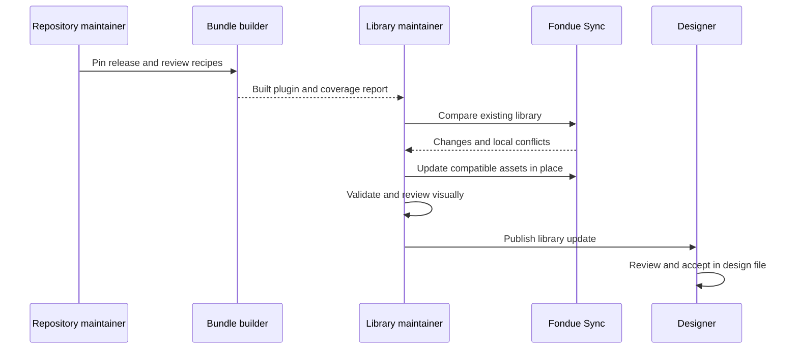

# Fondue Sync maintainer guide

Build, release and source-maintenance details for developers and library maintainers. For the everyday Figma workflow, see the [README](../README.md). For the PR companion and token-build configuration, see [Push changes](push-changes.md).

## Technical setup and maintenance

### Build the development plugin

Use Node.js 20 or newer and npm in the Fondue Sync repository.

```sh
npm ci
npm run build
```

This packages the checked-in release bundle. Import `dist/manifest.json` in Figma desktop. The bundle is embedded in the plugin, so an import does not require a live Fondue server or Figma token credentials. Import/Update do require Figma to confirm a saved recovery version before sync begins; offline or unsaved files may be blocked. Restoring a checkpoint is manual through Figma Version History and must be tested in the intended workspace.

### Prepare a release and verify it

Chart colors have a reviewed brand adaptation in `recipes/chart-colors.mjs`, applied after importing the pinned release tokens. It follows the [Frontify color guidelines](https://weare.frontify.com/document/2906#/design/color): Marker Purple highlights the primary series; Base neutrals represent supporting series, missing data and dim backgrounds. Light/Dark and hover/subtle roles use the same palette. These eleven adapted tokens carry explicit provenance; the upstream release and its token authoring files remain the baseline for all other roles.

```sh
npm ci
node scripts/prepare-source.mjs
npm run verify
```

The source preparation step downloads the pinned upstream release and verifies its commit. It can replace the task-owned `.cache/release` directory; do not keep authored work there. Verification regenerates the bundle, checks types, runs tests and builds the plugin.

The current baseline is **Fondue 13.11.1**, pinned to commit `ebcc9b8579a7f862f43a2732f5a5b9c3105e6796`. To adopt another release, update the tag and expected commit in `scripts/prepare-source.mjs`, plus `RELEASE`, `COMMIT` and registry provenance in `scripts/build-bundle.mjs`. Prepare the source, review changed components, tokens, recipes and coverage together, then regenerate and verify. Changing the version string alone is insufficient. Do not combine arbitrary package versions or use the adapted playground as the release source.

### Find the owning source

Paths below are relative to the Fondue Sync repository unless labeled upstream.

| Source | Responsibility |
| --- | --- |
| Upstream `packages/tokens/dist/` | Committed CSS, themes, JSON and token metadata consumed from the pinned release |
| Upstream component `*.metadata.json` files | Released purpose, usage and related-component guidance |
| `recipes/documentation.mjs`, `src/documentation.ts` | Metadata extraction, labeled editorial fallback, source links and concise family guides |
| `recipes/index.mjs`, `recipes/foundations.mjs`, `recipes/controls.mjs`, `recipes/patterns.mjs` | Reviewed native component definitions, complex parts, charts, rich text and represented properties |
| `recipes/examples.mjs`, `fixtures/demo.json` | Active product patterns, example screens and fictional content |
| `fixtures/media/manifest.json` and its image files | Approved offline image fixtures and their source asset references |
| `recipes/typography-bindings.mjs`, `recipes/paint-bindings.mjs`, `recipes/token-bindings.mjs` | Shared-style and variable mapping rules |
| `scripts/prepare-source.mjs`, `scripts/build-bundle.mjs` | Pinned source preparation and release-bundle generation |
| `src/` | Figma synchronization, rendering, metadata and plugin interface |
| `bundles/`, `docs/coverage.json` | Generated release bundle and coverage report; regenerate rather than editing by hand |

Some geometry bindings currently match numeric recipe values to tokens within the spacing, radius or border category. Review these mappings when the token scale changes; the builder does not trace every dependency in arbitrary React or CSS. Equal values do not prove the original source token reference. Values without a matching exported token remain explicitly labelled source-derived native constants.

### How synchronization works

The bundle carries stable definition identities, provenance and hashes. The plugin compares the previous import, the new definitions and the current managed Figma assets. Compatible changes are applied in place; local drift is reported before updating.

Tokens and shared styles are resolved before components so layers can reference their actual native IDs. Component descriptions, family guides, galleries and examples are generated from the same packaged definitions.



Run one maintainer sync per file at a time. Local automated checks verify generation and supported sync behavior; native Figma review verifies appearance, actual API behavior and instance preservation. Publication and cross-file consumer acceptance require their own validation.

For implementation details, use the [architecture](https://github.com/DannyRuchtie/fondue-sync/blob/main/docs/architecture.md), [verification checklist](https://github.com/DannyRuchtie/fondue-sync/blob/main/docs/verification.md), [runtime evidence](https://github.com/DannyRuchtie/fondue-sync/blob/main/docs/native-runtime-evidence.md), [example coverage](https://github.com/DannyRuchtie/fondue-sync/blob/main/docs/examples.md) and [remaining gaps](https://github.com/DannyRuchtie/fondue-sync/blob/main/docs/gaps.md).

Additional references: [native sections and browsing pages](sections.md), [optical icon sources](optical-icons.md), and [metadata storage measurements](metadata-capacity.json).

## Make changes that reach Figma

Make durable library changes in their owning source, or use **Push changes** to propose supported edits from a selected Figma component as a draft PR. Direct Figma edits remain local until the PR is reviewed, merged and released; they can be reported as conflicts on the next sync.

| What you want to change | Where the change belongs | How it reaches Figma |
| --- | --- | --- |
| Component purpose and when or how to use it | Released Fondue component metadata, where available | The builder reads the metadata and generates descriptions and guides |
| Component behavior, public properties or states | Fondue component source, with stories and metadata updated alongside it | A maintainer updates the reviewed Figma recipe for the supported representation |
| Colors, typography and other design tokens | Fondue’s existing token authoring process and committed release outputs | The builder imports the released token values, aliases and modes |
| Native component structure, variants, spacing or bindings | Reviewed recipes in the Fondue Sync repository | Rebuild the bundle and plugin, then compare and update |
| Reusable patterns, example layouts and dummy content | Fondue Sync pattern and example recipes | Update the generated references through the plugin |
| A product screen you are designing | Your own Figma design file | Your composition stays yours; its linked library instances can receive updates |

### Write component guidance with the component

Add or revise guidance when introducing a component, changing its intended use, adding a supported state, or finding that designers need clearer direction. Explain its purpose, when to use it, how to configure it, and any important limitations.

Where released metadata exists, the importer reads **description** for purpose, **instructions** for usage, and related-component references. For example, the component metadata convention is `packages/components/src/components/Button/Button.metadata.json` in Fondue.

The plugin adds the exposed Figma properties, representation limits and source links. It writes a native component description and documentation link, plus a concise guide beside the family. A source link points to the pinned release commit, so designers can see which implementation the imported guidance describes.

If released guidance is missing, the generator uses labeled Fondue Sync editorial guidance. Improve the upstream metadata for guidance that belongs to Fondue itself; use recipe documentation for Figma-specific instructions.

### Keep specifications and native mappings together

The code, stories and metadata describe the released component. The Figma recipe defines the subset represented as native layers and properties. Adding a new React component or prop does not automatically create a faithful Figma equivalent: a maintainer must add or review its recipe and coverage.

For example, changing a Button color token can flow through its existing variable binding. Adding a new Button variant also requires a native representation, property mapping and visual review.

The Sync tab reads committed token outputs from the selected release. Push proposals for new or changed tokens introduce reviewed repository-owned definitions alongside the upstream Figma inputs; the local companion must build their generated outputs before creating the draft PR. See [token ownership and setup](push-changes.md).

Fondue’s upstream token builder currently loads the owning Figma variables and commits generated outputs with a release. Changes therefore follow that established ownership and approval process first. Fondue Sync consumes those approved outputs; do not edit its temporary source cache or run the upstream live token builder as part of a normal plugin rebuild.

## Component categories

Native editable content regions are defined in recipes. See [content slots](content-slots.md) for the Surface implementation, instance-content ownership and migration restrictions.

Edit `src/component-categories.json` to assign a source family to a browsing category. Run `npm run verify` to regenerate and validate the bundled `libraryCategory` and `assetName` fields. Keep recipe `name`, IDs, source references and variant properties unchanged: display paths belong in `assetName`. New unmapped families fall back to Other; the coverage check requires an explicit category for every bundled component family. Gallery section keys remain stable while visible labels include category and family.

After installing the rebuilt plugin, Compare and Update the existing library, inspect category folders with Show subfolders enabled, then publish through Figma. Confirm an existing consumer instance still receives updates before publishing broadly.

### Organizing a library with local edits

Use **Organize components** for the category migration without a full source refresh. It checks the exact managed set IDs and old names before applying any names; missing sets and custom set names stop the operation. Styling, text, variant IDs, instance connections and existing non-name snapshot fields remain intact. Only `assetName`, `libraryCategory`, and the baseline root `name` are patched. Renderer revision, release fingerprint and other source definitions are not advanced. Non-name conflicts continue to require review in Compare. Per-component `organization-before` records retain the prior name and applied baseline; these complement the normal history checkpoint.
