# Push selected Fondue changes

Fondue Sync has two tabs: **Sync** imports and updates the released library; **Push changes** proposes changes from the current selection to `Frontify/fondue` as a draft pull request.

## Implementation and agent workstreams

The implementation is divided into four responsibilities, developed in parallel and integrated by the primary agent:

| Workstream           | Responsibility                                                                                                                          | Evidence                                                                                                  |
| -------------------- | --------------------------------------------------------------------------------------------------------------------------------------- | --------------------------------------------------------------------------------------------------------- |
| Selection agent      | Resolve selected components, variants, layers and instance overrides; compare imported baselines; collect referenced token dependencies | `src/push-selection.ts`, selection and real-source integration tests                                      |
| Source mapping agent | Inventory every recipe, resolve exact SCSS or static JSX utility targets, preserve calculated dependencies and detect conflicts         | `recipes/reverse-mappings.mjs`, `scripts/push-patches.mjs`, patch tests, `docs/reverse-coverage.json`     |
| PR service agent     | Authenticated local companion, exact diff previews, isolated token generation, GitHub branches/draft PRs and retry protection           | `scripts/push-service.mjs`, `scripts/push-github.mjs`, `scripts/push-validation.mjs`, service/build tests |
| Primary integration  | Accessible tabs, selection freshness checks, token review, durable token authoring, integration and browser checks                      | `src/push-ui.js`, `scripts/push-tokens.mjs`, token tests, browser evidence                                |

```mermaid
flowchart LR
    S[Selected Fondue object] --> D[Compare imported baseline]
    D --> T[Review component edits and token dependencies]
    T --> M[Resolve exact source declarations]
    M --> B[Build new or changed token exports in an isolated copy]
    B --> P[Preview exact source diff and changeset]
    P --> R[Create draft Fondue PR]
    R --> C[Repository CI and maintainer review]
    C --> L[Merge and release]
    L --> I[Normal Sync and Figma publication]
```

## Coverage and boundaries

The release contains 218 recipes: 200 upstream Fondue recipes and 18 plugin-owned production patterns. Every upstream recipe has source files available for source-target review. This is an inventory result, not proof that every property/state combination has been validated.

The mapper supports radius, padding, gap, dimensions, border width/color, solid fill/color, font size, line height, letter spacing and opacity where an exact source declaration exists. It understands nested SCSS declarations and static Tailwind strings inside JSX `className` expressions. Verified unique mappings can be automatic; otherwise preview lists source declarations for explicit review. Dynamic class computations, unsupported layout expressions, individual corner/edge cases without declarations and structural/behavior changes require an additional reviewed adapter. Arbitrary React generation is not attempted.

Select the component or instance you want to change. Selecting a layer narrows comparison to that layer and its descendants. Overlapping selections are deduplicated. Changed nested instances must be selected directly. Editing an instance proposes a shared component change, and changing a referenced shared token can affect every consumer. The plugin reports that wider scope; it never silently scans all library components to create a proposal.

A PR does not advance the import baseline or publish the Figma library. Only the normal release → Sync → publish flow does that. Existing source library drift remains protected by the Sync engine.

## Run the development workflow

1. Build the plugin with `npm run build` and import `dist/manifest.json` in Figma desktop.
2. Prepare a local Fondue checkout matching the desired target branch. The original imported release baseline remains in `.cache/release`; `npm run source` restores it if needed. Do not author changes in this cache.
3. Provide a GitHub token through `FONDUE_GITHUB_TOKEN` (or `GITHUB_TOKEN`) in the service process environment. It needs repository contents and pull-request write permissions on `Frontify/fondue`. GitHub App installation tokens are supported; the local companion does not implement OAuth or token refresh.
4. Start `npm run push:service`. It binds to loopback port 3848 and prints a temporary pairing secret. Paste that secret into **Push changes → Connect PR service**. Keep GitHub credentials out of Figma and the document.
5. Select an object and choose **Review selected object**. Review the included changes. For a raw or new variable value, choose an existing compatible token or name a new CSS token.
6. Enter a conventional PR title and rationale, then **Preview PR diff**. Resolve source target ambiguities and preview again. Review the exact files, warnings, changeset and validation status.
7. Acknowledge the shared component/token impact and choose **Create draft PR**. The service rechecks the target branch and file contents. Editing the document, selection or proposal invalidates the UI review; a new preview is required.

Configuration:

| Environment variable   | Purpose                                                                                        |
| ---------------------- | ---------------------------------------------------------------------------------------------- |
| `FONDUE_GITHUB_TOKEN`  | GitHub App installation or repository-scoped token; server-side only                           |
| `FONDUE_SOURCE_ROOT`   | Fondue source checkout; defaults to sibling `../source`                                        |
| `FONDUE_BASELINE_ROOT` | Pinned imported source; defaults to `.cache/release`                                           |
| `FONDUE_PUSH_BASE`     | Target branch; defaults to `main`                                                              |
| `FONDUE_PUSH_SESSION`  | Optional pairing secret of at least 24 characters; random by default                           |
| `FIGMA_ACCESS_TOKEN`   | Needed only for proposals that build new/changed tokens through the existing upstream pipeline |

The development UI and manifest use `http://localhost:3848`. Keep that default port for this build. Published distribution requires a separately deployed authenticated service and an explicit manifest domain; this implementation is a desktop development workflow.

## Token ownership and generated outputs

The PR proposes a committed `packages/tokens/repository-tokens.json` source and a Style Dictionary input hook. These repository-owned definitions are merged after Figma inputs and survive the scheduled Figma token build. Existing tokens continue to come from Figma unless explicitly overridden. Maintainers must review this ownership choice in the first token PR; reconcile or remove an override deliberately when returning ownership to the upstream Figma file.

Numeric values preserve the configured px/rem conversion, aliases remain references, and themed colors require Light and Dark values. Naming collisions, invalid values, unresolved aliases, cycles and unsupported modes block generation. The format is deterministic; it does not make an external live Figma fetch a reproducible snapshot.

A token proposal cannot create a PR from authored source alone. The companion requires `FIGMA_ACCESS_TOKEN` and an installed matching pnpm workspace, builds tokens in a disposable source copy, verifies manifest/CSS exports, and includes generated token outputs in the reviewed diff. Generation failures or unrelated upstream token changes block the proposal. Source checkouts and import baselines are not rewritten by this build.

## Validation and accessibility

Existing React semantics, handlers, props, ARIA and focus logic are preserved by targeting style declarations. This is a preservation strategy, not proof of accessibility. The draft PR identifies formatting, lint, types, builds, unit/component tests, keyboard/focus/labels/error states, contrast/target sizing and visual review as pending until actually run. Token generation is reported passed only after a successful isolated build. Maintainer review remains required.

Repository conventions come from `CONTRIBUTING.md`, component generator templates, existing component implementations, formatter/linter configuration, changeset checks and PR-title checks. Source mappings should be reviewed again when the imported release changes.

## Verification evidence

Run `npm run typecheck`, `npm test` and `npm run build`. Regenerate source coverage with `node scripts/build-reverse-coverage.mjs` after preparing the pinned release source.

Tests cover selection isolation, instance overrides, token dependency closure, source drift, calculated radius dependencies, padding shorthands, structural blockers, durable token inputs, authenticated previews, exact commits, stale bases, draft PR creation, idempotent retries and token export prerequisites. Real Button, Badge and TextInput release files are used in integration tests.

`docs/evidence/push-changes/browser.json` and `review.png` record a Chromium UI check with simulated Figma messages and a mocked PR service. Native Figma behavior and a live PR against Fondue have not been verified by those tests. No external PR is created by verification.

Implementation references: [Figma manifest networking](https://developers.figma.com/docs/plugins/manifest/), [GitHub draft pull requests API](https://docs.github.com/en/rest/pulls/pulls), [Style Dictionary source precedence](https://styledictionary.com/info/tokens/), [WCAG 2.2](https://www.w3.org/TR/WCAG22/).
