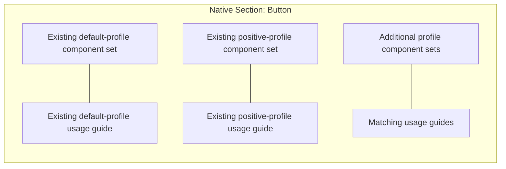

# Native sections and adjacent documentation

The library is organized by **component type**, using real Figma Section nodes. Button profiles share a Button section. Text profiles share a Text section. DatePicker, its Input and its represented compound parts share a DatePicker section. The grouping follows the first segment of the native recipe name and keeps components, charts, rich text and authored product patterns in their respective pages.

Each main set sits in a row with its matching usage guide immediately beside it. The guides explain purpose, intended use, exposed properties, source links and coverage limits for that set. Profiles keep their own guides so the documentation beside one variant matrix does not imply that every property is supported by every other profile. Figma's native component descriptions and documentation links remain available when selecting a set or component.

Section backgrounds bind to the existing semantic `color-surface-default` variable when available. Newly generated example captions bind their text fills to `color-primary-default`. The shared mode controls their appearance alongside the library assets; no duplicate presentation-only color tokens are created.

Icons share one native Icons section. Each authored example screen has its own section and an adjacent caption drawn from that example's bundle documentation. The organizer does not invent icon usage text or blank documentation frames.

## Identity and recovery

Section organization is a presentation step after native assets have been synchronized. It reparents existing main sets and guide frames with `appendChild`; it does not replace or clone those assets. Main component, variant, child, guide and connected-instance IDs remain intact.

The ledger records a stable group key and native Section ID. It also records example-caption IDs. New IDs are saved immediately, allowing the organizer to reuse them after an interruption. Repeating the step reuses the same sections and captions. A displayed name matching “Button” does not authorize adopting a user-created section; ownership comes from the ledger. A ledger ID pointing to a different native node type is a recovery error.

Sections use explicit measured positions and `resizeWithoutConstraints`. They do not use Auto Layout. Each row measures the actual set and guide bounds. Page layout uses at most two columns, gives unusually wide families their own row, and advances by the tallest section in the row to avoid overlapping sections.

Unrelated page nodes are not moved or deleted. The section grid starts below them. Untracked children placed inside a managed section keep their local positions; generated rows start below them. The organizer never deletes empty previous pages, so the former Documentation page may remain after its managed guides move beside their sets.

Example captions preserve local text edits and report a warning. Source-backed captions update only when their current text still matches the last applied caption. Guide frames remain normal sync-managed assets and use the engine's existing local-drift checks.

## Verification

`tests/sections.test.ts` covers family grouping, adjacent guide placement, preservation of existing identities, no name-based adoption, repeated organization, interruption recovery, correct pages, source-backed captions, semantic presentation bindings, unrelated content and packing of uneven bounds. Its strict Section mock rejects Auto Layout and enforces native section resizing methods.

Native Figma verification must additionally inspect actual Section nodes, guide wrapping and layout, and compare existing IDs before and after grouping. Local tests alone do not prove a completed canvas migration.
